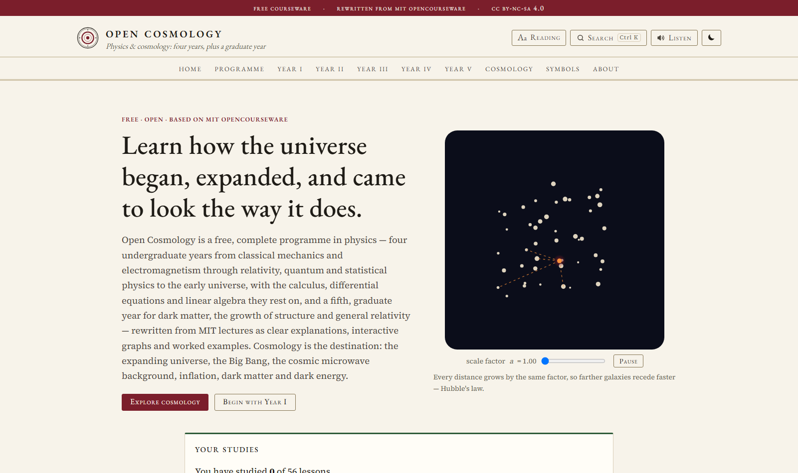
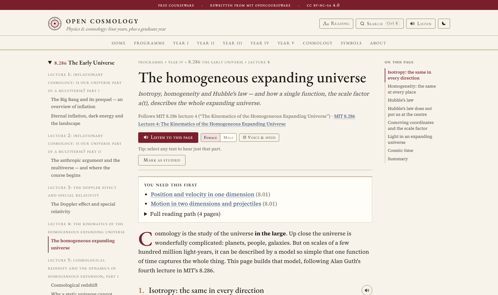

<p align="center">
  <a href="https://opencosmology.eu">
    
  </a>
</p>

<h1 align="center">Open Cosmology</h1>

<p align="center">
  <em>A free, open programme in physics and mathematics, leading to cosmology: four undergraduate years and a graduate year.</em><br>
  <strong><a href="https://opencosmology.eu">opencosmology.eu</a></strong>
</p>

<p align="center">
  <a href="https://opencosmology.eu">Visit the site</a> ·
  <a href="https://opencosmology.eu/courses">The Programme</a> ·
  <a href="https://opencosmology.eu/courses/8-286">Cosmology (8.286)</a> ·
  <a href="https://opencosmology.eu/about">About</a>
</p>

---

## What is Open Cosmology?

Open Cosmology teaches **how the universe began, expanded and came to look the way it does** — the expanding universe, the Big Bang, the cosmic microwave background, inflation, dark matter and dark energy — together with **all the physics and mathematics you need to understand it**.

It is organised like a university degree: **four years of undergraduate courses**, following the undergraduate physics curriculum of the Massachusetts Institute of Technology (MIT), **and a fifth, graduate year** with two MIT graduate courses — inside each course, MIT's own lecture order. Every page is **rewritten in plain, clear language** from the lectures, notes and transcripts that MIT publishes freely on [MIT OpenCourseWare](https://ocw.mit.edu).

New to physics? Before Year I comes the **High School** (`/highschool`): nine blocks of pre-university physics and maths, at about Dutch VWO level, from a maths toolkit to the Big Bang, with its own notebook and aubergine colours. Its lesson lists are in place; its lessons are still to be written ([docs/HIGHSCHOOL-PLAN.md](docs/HIGHSCHOOL-PLAN.md)).

The site is **free, has no ads and no paid features**, and its content is openly licensed (CC BY-NC-SA 4.0; the code is MIT-licensed).

## The programme

| Year | Courses |
|------|---------|
| **I** | 8.01 Classical Mechanics · 18.01 Single Variable Calculus · 8.02 Electricity and Magnetism · 18.02 Multivariable Calculus |
| **II** | 8.03 Vibrations and Waves · 18.03 Differential Equations · 8.033 Relativity · 18.06 Linear Algebra · 8.04 Quantum Physics I |
| **III** | 8.044 Statistical Physics · 8.05 Quantum Physics II · 8.06 Quantum Physics III |
| **IV** | **8.286 The Early Universe** |
| **V** (graduate) | 8.902 Astrophysics II (dark matter and structure formation) · *Fundamentals of Dark Matter* (Ferreras, an open textbook, UCL Press, CC BY-NC 4.0) · 8.962 General Relativity — graduate-level material, usually taken after the bachelor's core |

Cosmology is the destination and the largest part. Earlier courses show where each idea is used later in cosmology, and the homepage lets you read the programme backwards, from the early universe to the foundations.

## What each lesson offers

<p align="center">
  
</p>

- **Clear explanations** that follow the MIT lecture, section by section.
- **Every formula cited** to the exact MIT slide, transcript page or course-note equation.
- **Interactive graphs** computed from the formulas, with sliders to explore them.
- **Worked examples** revealed step by step, plus a **quiz** and **flashcards** on every page.
- **Prerequisites first**: each page lists what to read before it, and where it leads in cosmology.
- **Read aloud**: listen to a whole page, one section or selected text, with a choice of voices; it can carry on through the whole programme.
- **Accessible to everyone**: text size up to 200%, extra spacing, an easy-to-read or dyslexia-friendly font, high contrast, no animations, full keyboard use and screen-reader support — every graph can also be shown as a table of values.
- **Track your studies**: mark lessons as studied (or pass their quiz), see your progress per course, and get a suggested next lesson whose prerequisites you have finished. Saved only in your browser.
- **Search** across all courses, an **"On this page"** guide on long lessons, **light and dark** reading modes, and a layout that works on phones, tablets and desktops.
- **Interactive simulations** from PhET on early physics lessons.
- **Symbols and notation**: tap any symbol in a formula to see what it means on that page and how to say it; every lesson lists its symbols, and a glossary has one page per year.
- **Focus mode** for reading one part at a time, and a **flashcard review** with spaced repetition across all the lessons you have studied.
- **Works offline and installs like an app**: save courses for offline reading, or add the site to your home screen (iPhone: Share → Add to Home Screen; Android and desktop: Install). It updates itself when the site changes.

## How the content is made

1. A lecture's MIT sources — course notes, slides and the lecture transcript — are read in full.
2. The page is written in original words, following MIT's order. Worked examples use their own numbers, and every number is recalculated.
3. A **separate review** compares the page with the MIT sources: every formula, citation, number and quiz answer. All findings are fixed before the page is published, and the review is kept in [`reviews/`](reviews).

Material that MIT marks "All rights reserved" is never reused; the site draws its own diagrams instead.

## Progress

**414 lessons** are online (November 2026), every one checked against its MIT source by an independent review:

| Year | Online |
|------|--------|
| **I** | 8.01 Classical Mechanics complete · 18.01 and 18.02 nearly complete (31 of 35 lectures each) · 8.02 Electricity and Magnetism under way (21 of 36) |
| **II** | 18.03 Differential Equations complete · 8.03, 8.033, 18.06 and 8.04 nearly complete |
| **III** | complete: 8.044 Statistical Physics, 8.05 Quantum Physics II and 8.06 Quantum Physics III |
| **IV** | **8.286 The Early Universe complete** (all 23 lectures) |
| **V** | **8.902 Astrophysics II complete** (galaxies, cosmology, structure formation, the CMB and the early universe) · *Fundamentals of Dark Matter* (17 lessons) · 8.962 not started |

The courses marked "nearly complete" mostly lack their exam-review and exam lectures. Every course in the table already has its lecture list on the site, so you can see what is coming. Problem sets with answer boxes that check your work have started with one pilot set (8.286 Problem Set 1); more sets, practice exams and lab work are planned (see the [roadmap](ROADMAP.md)), and so are pages on the people behind the ideas, how we know what we know, and the open questions of the field ([docs/PLAN.md](docs/PLAN.md) §8).

## Credits and licence

- Course material is rewritten from **[MIT OpenCourseWare](https://ocw.mit.edu)**, published by the Massachusetts Institute of Technology under [CC BY-NC-SA 4.0](https://creativecommons.org/licenses/by-nc-sa/4.0/). Each page credits the course, its instructors and the lecture it follows. **MIT and the instructors do not endorse this site.**
- Simulations: [PhET Interactive Simulations](https://phet.colorado.edu), University of Colorado Boulder, licensed CC BY-NC 4.0.
- This site's content (lessons, quizzes, diagrams, symbols, calculations, reviews): [CC BY-NC-SA 4.0](LICENSE). You may share and adapt it for non-commercial purposes, with attribution, under the same licence.
- The code that builds the site: [MIT License](LICENSE). See [LICENSE](LICENSE) for which folders are which.

## For contributors

The site is built with Next.js and generated entirely from the content folder: adding a lesson means adding one file.

- [docs/DEVELOPMENT.md](docs/DEVELOPMENT.md) — running the site, how it works, components, read-aloud, review pipeline, icons.
- [docs/CONTENT_GUIDE.md](docs/CONTENT_GUIDE.md) — how to write a lesson and cite sources.
- [AGENTS.md](AGENTS.md) — the full guide for AI assistants (Cursor, Claude): scope, work order, writing and design rules.
- [ROADMAP.md](ROADMAP.md) — the plan: more lessons, problem sets, exams and lab work.
- [OWNER-TODO.md](OWNER-TODO.md) — tasks and decisions for the site owner.

```bash
npm install
npm run dev     # http://localhost:3000
npm run build   # validates all content, then builds
```
